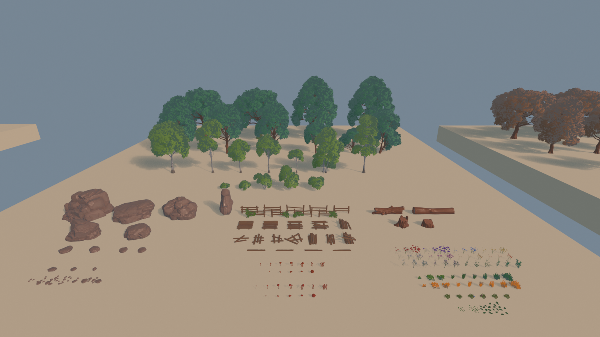
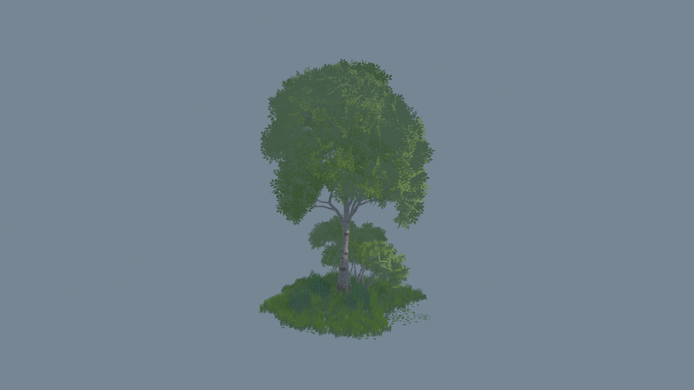

# Authored Meadow scene layouts

These scenes preserve the original author's static arrangements from the Meadow Unity package. Use them to inspect or reuse the author's placement, grouping, scale, and material choices in Three.js.

| Scene | Static placements | Source arrangement |
| --- | ---: | --- |
| Overview | 369 | 361 environment models plus eight visible Cube display platforms/backdrops; seasonal collections and distant scenery. |
| DioramaExample | 609 | Seven original diorama groups, with 87 static placements per group. |
| Total | 978 | Authored static placements, not 978 different source models. |

## Read a small amount of text first

1. Read [index.json](index.json) to choose a scene, view, or group.
2. Read that scene's [Overview summary](overview/summary.json) or [Diorama summary](diorama/summary.json).
3. Follow only the needed groups[].path entries for small JSON descriptions. Each group document includes source identity, group hierarchy, local transforms, and object-to-library references.
4. Use the scene's model path to load the complete static arrangement. The full [Overview layout](overview/layout.json) and [Diorama layout](diorama/layout.json) provide the complete published hierarchy and placement metadata when needed.

Open the [authored-scene browser viewer](../examples/authored-scenes.html), or read [Claude instructions and a copyable prompt](../CLAUDE_AUTHORED_SCENES.md). The root asset catalog remains the entry point for individual models; this scene index is the entry point for the author's assembled arrangements.

## Load the authored scene

Use Three.js 0.180.0 for both the core library and addons, as in the included viewer. Preserve the original URL so GLTFLoader resolves all shared buffer and texture dependencies.

~~~js
import { GLTFLoader } from 'three/addons/loaders/GLTFLoader.js';

const base = 'https://raw.githubusercontent.com/kk20054/ThreeJS-Stylized-World-Assets/main/';
async function readJSON(path) {
  const response = await fetch(new URL(path, base));
  if (!response.ok) throw new Error(path + ': HTTP ' + response.status);
  return response.json();
}
const catalog = await readJSON('scenes/index.json');
const entry = catalog.scenes.find(item => item.id === 'diorama');
if (!entry) throw new Error('Unknown authored scene');
const summary = await readJSON(entry.summary);
const gltf = await new GLTFLoader().loadAsync(new URL(entry.model, base).href);
scene.add(gltf.scene);
~~~

The scene.gltf files reference shared external resources. Copying or uploading only the glTF JSON is incomplete. To vendor a scene, retain every transitive dependency with its relative path, or rewrite the URIs deliberately. Pin the repository URL to a full commit SHA when reproducibility matters. A public text URL does not prove that a particular Claude account has fetched binary files or executed WebGL.

## Preserve the layout contract

- Keep the source hierarchy and each local transform. Nonuniform parent scale combined with child rotation produces real world shear in parts of Overview. Do not flatten world matrices into decomposed position/rotation/scale.
- The declared conversion is flip X, H = diag(-1, 1, 1, 1). The original Unity values remain in layout metadata; published glTF matrices use the declared basis. See the [UnityGLTF coordinate discussion](https://github.com/KhronosGroup/UnityGLTF/issues/290).
- IDs are strings. Retain source instance/transform/renderer IDs and library asset references when adapting the scene.
- Do not recenter, normalize, rescale, or randomly redistribute individual objects. Existing library mesh nodes contain native scale/pivot transforms that are already included once in the assembled scene.
- If adapting a whole group for a new world, use one outer wrapper and clearly record that group-level translation. Preserve every relative placement inside it. When extracting a nested group, preserve its necessary parent transform chain.
- Loading scene.gltf already applies its hierarchy. The world matrices in JSON are inspection evidence; do not apply them a second time to loaded objects.

## Source camera and inspection views

Only the view named source-camera reproduces the source camera's position, direction, up vector, and projection. It is a local composition, not an all-scene panorama. Complete-layout and per-group views are additional bounds-based inspection cameras. Their wider framing does not represent another camera found in the Unity source.

## Static conversion scope and image provenance

The two scenes retain **35 source particle/effect anchors** as metadata: 21 in Overview and 14 in Diorama. Dynamic particle behavior is not reproduced. Colliders, ASP global settings, Unity sky rendering, post-processing, wind, noise, and vertex-mask shading are not claimed as equivalent Three.js behavior. Both summaries record one unresolved non-geometric GlobalTreeSSSDistance override rather than silently claiming full runtime conversion.

The eight visible Overview Cube platforms are original renderers and remain visible. Diorama's Invisible Floor has a collider but no source renderer, so it is not introduced as a visible ground plane.

Preview PNG paths and view identifiers are supplied by index.json and per-scene preview receipts when present. **The reference PNGs are Blender renders of the converted layout, not original Unity screenshots.** Their receipts identify the renderer, view, dimensions, and source. They help inspect composition and material output; they do not establish Unity shader equivalence, complete browser QA, or original-author visual approval. Do not infer a fixed preview count from this document.

## Reference gallery

There are 18 verified 1600 × 900 PNG references: complete layout, original source camera, and seven group views for each scene. The scene index lists their paths, byte lengths, SHA-256 hashes and view labels.

[Overview references](overview/preview-receipt.json) · [Diorama references](diorama/preview-receipt.json)

The portable Three.js inspection viewer adds hemisphere and ambient fill to the source directional parameters. This avoids unlit back faces in the absence of Unity sky/SSS; it does not claim original lighting parity.

[Transform checks](validation/authored-transforms.json) · [Official glTF checks](validation/gltf-validation.json) · [Recovered foliage alpha](validation/foliage-alpha.json)
